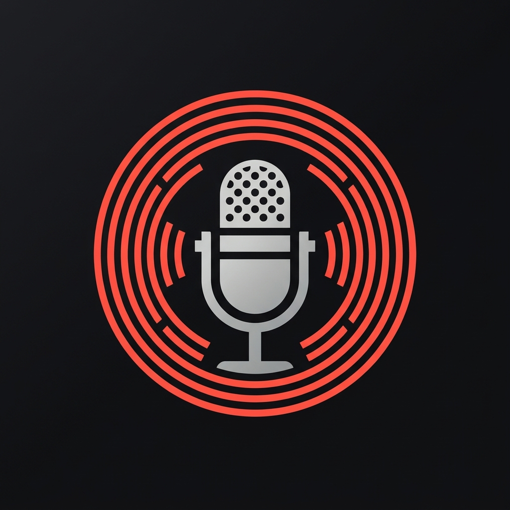

<p align="center">
  
</p>

<h1 align="center">Voice-recorder-MP3</h1>

<p align="center">
  <strong>A fast, modern, native-MP3 Android voice recorder built with Kotlin, Jetpack Compose, and FFmpeg + LAME.</strong>
</p>

<p align="center">
  <a href="https://github.com/webapandroid-oss/Voice-recorder-MP3/releases/latest">
    
  </a>
  <a href="LICENSE">
    
  </a>
  
  
  
  
</p>

<p align="center">
  <a href="https://github.com/webapandroid-oss/Voice-recorder-MP3/releases/latest"><strong>📥 Download Latest APK</strong></a> •
  <a href="#-features"><strong>✨ Features</strong></a> •
  <a href="#-build-from-source"><strong>🛠️ Build from Source</strong></a> •
  <a href="#-license"><strong>⚖️ License</strong></a>
</p>

**Voice-recorder-MP3** captures microphone audio and encodes it directly to real `.mp3` files in real time—no bulky WAV intermediates, no post-recording waiting, and no extra clutter. Designed with a clean studio-inspired Material Design 3 interface, it gives you live waveform metering, configurable bitrates up to 320 kbps, background recording controls, and an inline MP3 player all in one lightweight app.

---

## 📥 Download

Download the latest signed release APK directly from **[GitHub Releases](https://github.com/webapandroid-oss/Voice-recorder-MP3/releases/latest)**.

- Supports `arm64-v8a`, `armeabi-v7a`, `x86_64`, and `x86` architectures (with 16 KB page-size support).
- Built-in in-app release updater verifies SHA-256 checksums and signing certificates before installation.

---

## ✨ Features

- **Native Real-Time MP3 Encoding:** Powered by a custom minimal `libffmpeg.so` (FFmpeg 6.1.2 + LAME 3.100) compiled for `arm64-v8a`, `armeabi-v7a`, `x86_64`, and `x86` with 16 KB page-size support.
- **Live Studio Waveform & dBFS VU Meter:** Watch a responsive 56-bar real-time waveform, 28-segment color-coded VU meter, tenth-of-a-second precision timer (`MM:SS.d`), and live encoded file size while recording.
- **Configurable MP3 Quality:** Customize output quality before recording from **⋮ → Quality Settings** with live storage estimates (`~MB/min`):
  - **Bitrates:** `96 kbps` (Compact Voice), `128 kbps` (Standard MP3), `192 kbps` (High Fidelity), `320 kbps` (Studio Master)
  - **Sample Rates:** `22.05 kHz`, `44.1 kHz`, `48 kHz`
  - **Channels:** `Mono` or `Stereo`
- **Background Recording Service:** Uses an Android Foreground Service (`microphone`) so recording continues smoothly when you lock your screen or switch apps, complete with **Pause / Resume** and **Save MP3** notification controls.
- **Pause, Resume & Safe Discard:** Pause and continue within the same MP3 file seamlessly, or discard unwanted takes (with a confirmation prompt for recordings of 3 seconds or longer).
- **Direct Storage Saving (No Cache):** Recordings are encoded and saved directly to `/storage/emulated/0/Music/Voice Recorder` (Internal Storage) or `Music/Voice Recorder` on an inserted **SD card**—no temporary cache files.
- **SD Card Prompt & Quick Switcher:** Automatically asks **"Save recordings to SD cards?"** when an SD card is inserted, and lets you switch anytime via **⋮ → Change storage location to Internal Storage / SD card**.
- **Custom Recording Titles:** Set a custom filename before hitting record, or let the app auto-name files as `Recording_dd_MM_yyyy_HH_mm_ss.mp3`.
- **Recordings Library & File Management:**
  - Instant search by recording title or filename
  - Quick sorting by **Newest**, **Oldest**, **Longest**, or **Largest**
  - **Rename**, **Share**, **Save (Export)** to device storage, and **Delete**
- **Audio-to-MP3 Converter:** Convert compatible audio files (`.mp3`, `.wav`, raw PCM) directly inside the **Recordings** tab using your active MP3 quality settings.
- **Built-In Inline MP3 Player:** Play recordings directly inside the library cards with a seek slider, `-10s` / `+10s` skip buttons, and playback speed control (`0.75x`, `1.0x`, `1.25x`, `1.5x`, `2.0x`).
- **Adaptive Phone & Tablet Layout:** Automatically switches from a bottom navigation bar on phones to a side-by-side **Record + Recordings** split view on large screens (`>= 840dp`).
- **In-App Release Updater:** Checks for new GitHub Releases, verifies APK SHA-256 checksums and signing compatibility, shows release notes, and installs updates in-app.

### MP3 Quality Presets at a Glance

| Preset | Bitrate | Approximate Size | Best For |
| :--- | :--- | :--- | :--- |
| **Compact Voice** | `96 kbps` | ~0.72 MB/min | Long lectures, voice memos, minimal storage |
| **Standard MP3** | `128 kbps` | ~0.96 MB/min | Everyday notes and meetings |
| **High Fidelity** *(Default)* | `192 kbps` | ~1.44 MB/min | Clear interviews, podcasts, vocal recordings |
| **Studio Master** | `320 kbps` | ~2.40 MB/min | Maximum MP3 fidelity |

---

## 🎙️ How to Record

1. Open the app on the **Record** tab.
2. *(Optional)* Tap **⋮ (More Options)** in the top-right corner → **Quality Settings** to pick your **Bitrate**, **Sample Rate**, and **Mono / Stereo** channel mode.
3. *(Optional)* Enter a custom name in the **Title** field before starting.
4. Tap the large circular **Microphone** button at the bottom center.
   - Allow **Microphone** permission when prompted.
   - On Android 13+, allow **Notifications** permission so live recording controls appear in your notification shade.
5. While recording:
   - Tap the center **Pause** button anytime to pause, and **Play** to resume.
   - Tap the **✕ (Discard)** button on the left to cancel the recording without saving it.

---

## 💾 How to Save

### 1. Finish & Save Directly
- While recording or paused, tap the **Stop (`■`)** button on the right side of the control deck—or tap **Save MP3** directly on the ongoing recording notification.
- The app flushes the MP3 encoder and saves your `.mp3` file directly into `Music/Voice Recorder` on your active storage location (**Internal Storage** `/storage/emulated/0/Music/Voice Recorder` or **SD card** `Music/Voice Recorder`).

### 2. Switch Between Internal Storage & SD Card
- When an SD card is inserted while Internal Storage is selected, opening the app prompts **"Save recordings to SD cards?"** (**Cancel** / **Change**).
- To switch manually anytime while an SD card is inserted, tap **⋮ (More Options)** in the top-right corner and choose **Change storage location to SD card** or **Change storage location to Internal Storage**.

### 3. Copy an SD Card Recording to Internal Storage
1. Open the **Recordings** tab.
2. Tap **⋮** on any recording card.
3. Tap **Save** to copy it to Internal Storage (`Music/Voice Recorder/<filename>.mp3`).

---

## 🎧 How to Listen to Recordings

1. Open the **Recordings** tab (or view the right panel on tablets/foldables).
2. Browse, search by name, or sort using **Newest**, **Oldest**, **Longest**, or **Largest**.
3. Tap the **Play (`▶`)** button on any recording card to start listening.
4. Use the inline player controls that expand inside the card:
   - **Play / Pause (`▶` / `⏸`)** to pause or resume.
   - **Progress Slider** to jump to any timestamp.
   - **`-10s` / `+10s`** buttons to skip backward or forward by 10 seconds.
   - **Speed Button (`1.0x`)** to cycle through `0.75x`, `1.0x`, `1.25x`, `1.5x`, and `2.0x`.

---

## ⚠️ Warnings & Known Limitations

Please keep the following caveats and potential issues in mind before using the app:

- **Audio-to-MP3 Converter Format Limit:** Although the system file picker lets you browse general audio files, the bundled `libffmpeg.so` is intentionally built as an MP3-only library supporting **MP3, WAV, and raw PCM** (`pcm_s16le`, `pcm_s24le`, `pcm_s32le`, `pcm_f32le`, `pcm_u8`) inputs. Attempting to convert `.m4a`, `.aac`, `.ogg`, `.flac`, or `.opus` files will fail.
- **SD Card Removal & Android 7–9 Permissions:** Removing an SD card while SD card storage is selected will prevent new recordings until the SD card is reinserted or you switch back to Internal Storage from **⋮ (More Options)**. On Android 7.0–9 (API 24–28), saving directly to Internal `Music/Voice Recorder` requires storage permission, and SD card access may ask you to select the SD card folder once via the system folder picker.
- **Quality Settings Are Locked Mid-Recording:** You cannot change bitrate, sample rate, or channel mode while a recording is active or paused. Stop or discard the active session first.
- **Hardware Microphone Compatibility:** Some Android devices do not support **Stereo** microphone capture or certain sample rates (such as `22.05 kHz` or `48 kHz`) in `AudioRecord`. If microphone initialization fails, switch back to **Mono** at **44.1 kHz**.
- **Battery Optimization & Background Interruptions:** Aggressive manufacturer battery savers (such as MIUI, ColorOS, FunTouch OS, or One UI background limits) may stop long background recordings or delay background update checks unless battery optimization is disabled for the app.
- **Microphone & Notification Permissions:** Denying microphone access blocks recording until granted in system Settings. Denying notifications on Android 13+ hides the ongoing pause/save notification controls and update alerts.
- **In-App Update Permissions & Signing Key Mismatch:**
  - Installing updates directly from inside the app requires granting **"Install unknown apps"** permission for Voice Recorder.
  - If you switch between a locally built **debug** APK and a signed **release** APK, Android will fail to install over the existing app due to a signing certificate mismatch—export your recordings first, uninstall the old build, then install the new APK.
- **Storage Space & Data Usage:** High-bitrate recordings (especially `320 kbps` at ~2.4 MB/min) require adequate free storage; running out of space mid-recording can cause saving to fail. Automatic background update checks also require internet access.

---

## 🛠️ Build from Source

### Prerequisites
- **JDK 21** and **Android SDK** (API 36 / Build-Tools 36.0.0)
- Prebuilt `libffmpeg.so` binaries are already included in `app/src/main/jniLibs/`

### Build Commands
```bash
git clone https://github.com/webapandroid-oss/Voice-recorder-MP3.git
cd Voice-recorder-MP3
gradle assembleDebug
```

To rebuild the native MP3-only `libffmpeg.so` libraries (`FFmpeg 6.1.2` + `LAME 3.100`) from source using the Android NDK:
```bash
bash app/src/main/cpp/build_libffmpeg.sh
```

---

## ⚖️ License

Copyright © 2026 **webapandroid-oss**

This project is licensed under the **GNU General Public License v3.0 (GPL-3.0)** — see the [LICENSE](LICENSE) file for details.

- Anyone using, modifying, or redistributing this project must preserve the original copyright notice and license, document changes, and release derivative works under **GPL-3.0**.
- The bundled native MP3 audio engine (`libffmpeg.so`) compiles **FFmpeg 6.1.2** and **LAME 3.100** under LGPL-compatible build flags (`app/src/main/cpp/build_libffmpeg.sh`).
